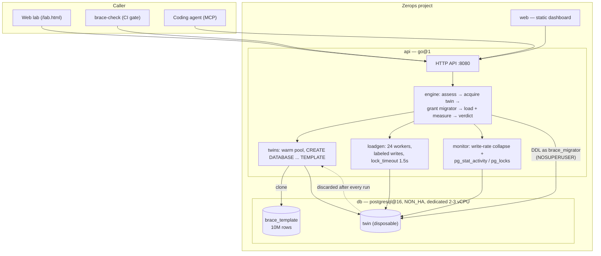

<p align="center">
  
</p>

<h3 align="center">The crash-test lab for Postgres migrations.</h3>

<p align="center">
  Clone a 10M-row production-scale twin, run your DDL against 24 concurrent write workers under a 1.5s lock timeout, and count how many writes died — SQLSTATE 55P03, not a guess.
</p>

<p align="center">
  <a href="LICENSE"></a>
  
  
  <a href="https://web-2a61.prg1.zerops.app"></a>
  
</p>

<p align="center">
  <a href="https://web-2a61.prg1.zerops.app/lab.html"><b>Crash a migration right now →</b></a>
  &nbsp;·&nbsp;
  <a href="#quickstart">Deploy your own on Zerops</a>
</p>

<p align="center">
  <br>
  <sub>A naive <code>CREATE INDEX</code>, live: writes crater to zero, the freeze timer runs, and the casualty count climbs — on a throwaway twin, not your users.</sub>
</p>

---

## Same SQL, two fates

A plain `CREATE INDEX` and the same index built `CONCURRENTLY` leave the database in an identical state. One is a half-minute outage; the other is invisible.

```sql
-- what most people ship — takes a SHARE lock, freezes every write on the table
CREATE INDEX idx_orders_customer_id ON orders (customer_id);
```

Run that against Brace's 10M-row twin under live checkout/login/cart traffic: **28.0 seconds** of frozen writes, **432 writes** died mid-checkout — real `55P03` (`lock_not_available`) errors, measured, not a simulation of them.

```sql
-- one word — no blocking lock, writes never stop
CREATE INDEX CONCURRENTLY idx_orders_customer_id ON orders (customer_id);
```

Same index, same twin, same traffic: **0.00 seconds** frozen, **0 writes** died.

That contrast — measured, on a full-size twin, under real concurrent writes — is the whole product. Brace doesn't read your SQL and guess; it runs it and counts the bodies.

<p align="center">
  <br>
  <sub>The report card, from that exact run — freeze measured two independent ways (28.0s / 28.0s), casualties by label, the lock explained in plain English, and the freeze projected onto a 100M-row table.</sub>
</p>

## Why not just lint it

A linter reads the statement and pattern-matches against known-dangerous shapes. That's fast and free, and it is also why `ADD COLUMN z serial` — which *looks* like the harmless case — passes most linters and then holds the same table-rewrite lock as the `DEFAULT random()` version. Brace doesn't read the SQL and guess; it runs the SQL and counts the bodies.

| Tool | What it checks | Runs under load? | Reports user impact? |
|---|---|---|---|
| [squawk](https://github.com/sbdchd/squawk), [Atlas lint](https://atlasgo.io), [strong_migrations](https://github.com/ankane/strong_migrations) | Static rules against known-dangerous SQL shapes | No | No — a lint pass, not a measurement |
| [eugene](https://github.com/kaaveland/eugene) | Runs the migration and traces locks taken | No — no concurrent load | No — reports locks held, not writers killed |
| [Postgres.ai DB Migration Checker](https://postgres.ai) | Prod-scale clone, runs the migration | No — clone is idle | No — measures lock duration, not casualties |
| [pgfence](https://github.com/flvmnt/pgfence) | Lints + traces a solo migration run | No | No — no concurrent writers to hurt |
| gh-ost / pt-online-schema-change | Executes online schema changes | Yes, but for MySQL | N/A — executor, not a measurement tool |
| **Brace** | Runs **your** migration on a production-scale twin under **real concurrent write load** | **Yes** | **Yes — counts writes that actually died (55P03), by label** |

The honest counter: a linter answers in 200ms with zero infrastructure. Brace needs a twin and a couple of minutes. Run the linter on every commit; run Brace before the migration touches production. They're complementary, not competing.

## Quickstart

Brace needs a real Postgres **superuser** (to create/drop twin databases) and native `CREATE DATABASE … TEMPLATE` cloning — both rare on managed Postgres, both native to [Zerops](https://zerops.io).

**Deploy your own:**

```sh
zcli project project-import ./import.yml   # 3 services: db, api, web
zcli push --serviceId <api-id>             # setup: api — builds cmd/brace
zcli push --serviceId <web-id> --setup web --workingDir ./web
```

That's it — three services (`db`: `postgresql@16`, dedicated 2–3 vCPU, `NON_HA`; `api`: `go@1`; `web`: `static`), wired by `zerops.yml` and `import.yml` in this repo. The api seeds its own 10M-row template on first boot; `/healthz` answers immediately, `/api/*` reports `{"error":"starting"}` until the template is warm.

**Or just use the public lab** — no deploy, no login: **[web-2a61.prg1.zerops.app/lab.html](https://web-2a61.prg1.zerops.app/lab.html)**

## The 15-minute tour

1. **Open the lab.** [`/lab.html`](https://web-2a61.prg1.zerops.app/lab.html) — pick a preset migration (naive `ADD COLUMN`, `serial`, `ALTER COLUMN TYPE`, naive `CREATE INDEX`, `REINDEX`) or paste your own DDL. *Expect: a warm-twin indicator and a Run button within a second or two.*
2. **Run the naive version.** Watch the write-rate chart. *Expect: a visible collapse to zero writes/sec, a red UNSAFE verdict, a casualty count, and the exact lock mode taken.*
3. **Run the safe rewrite** the report suggests. *Expect: a flat write-rate line, 0.00s blocked, 0 casualties, green SAFE.*
4. **Try the CLI gate.** `./brace-check "CREATE INDEX idx_orders_email ON orders (email);"` — exit code 0 (SAFE) or 1 (UNSAFE), CI-ready. *Expect: UNSAFE, since this is the naive form.*
5. **Add a scale projection.** `./brace-check -target-rows 500000000 -f migration.sql` — same measurement, projected onto a table 50x the twin's size. *Expect: a statement that was borderline on 10M rows now clearly UNSAFE at 500M — the projection, not the twin, is what fails the gate.*
6. **Point an agent at it.** Run `mcp/server.py` (FastMCP, stdio) from Claude Code or any MCP client and call `check_migration("ALTER TABLE ...")` before the agent deploys anything. *Expect: the same verdict/casualties/suggestion JSON the web lab shows, so a coding agent can ask "will this hurt?" before it ships a migration.*
7. **Read the report card literally.** Blocked seconds, baseline writes/sec, lock modes taken, and — on UNSAFE — the suggested rewrite are all in the JSON at `/api/stats`, not just the UI.

## Architecture



Private network between `web` / `api` / `db`; the api service is the only thing that ever holds `BRACE_ADMIN_URL` (the superuser DSN, injected from the `db` service's Zerops-managed reference, never checked into git). One `import.yml` stands up all three services; nothing about self-hosting requires forking the code.

## Security model

Judge-submitted SQL is never trusted to a regex. It runs as **`brace_migrator`** — `LOGIN NOSUPERUSER NOCREATEDB NOCREATEROLE NOREPLICATION NOBYPASSRLS`, a fresh random password rotated every process start, owning nothing outside the disposable twin. PostgreSQL itself — not application code — refuses everything below for that role:

- `COPY TO/FROM PROGRAM` (no shelling out)
- `pg_read_file()` and server-side file access
- `DROP DATABASE` / `CREATE DATABASE` (can't touch anything outside its own twin)
- `pg_terminate_backend` and role escalation

This was verified with a hostile pentest suite (`internal/qa`) that specifically attacks the casualty-counting logic itself — trying to get non-lock-timeout errors (`57014 query_canceled`, `40P01 deadlock_detected`, wrapped/lowercased/truncated SQLSTATEs) misclassified as casualties, and trying `COPY TO PROGRAM` / `pg_read_file` against the role directly. The pre-submission allowlist (only `CREATE INDEX`, `ALTER TABLE`, `REINDEX`, `VACUUM`, etc. get past the API) is UX and blast-radius hygiene — it tells you the rehearsal doesn't apply before an 80-second twin clone finds that out. It is explicitly **not** the security boundary; the role is.

## Measured, not projected

One run, 10M-row twin, ~12k writes/sec baseline, real Zerops hardware (`db`: dedicated 2–3 vCPU, PostgreSQL 16, `NON_HA`):

| Migration | Verdict | Freeze | Writes killed |
|---|---|---|---|
| `ALTER TABLE ... ADD COLUMN ... NOT NULL DEFAULT random()` | 🔴 UNSAFE | 31.0s | 480 |
| `ADD COLUMN z serial` *(looks harmless — isn't)* | 🔴 UNSAFE | 26.2s | 408 |
| `ALTER COLUMN ... TYPE ...` | 🔴 UNSAFE | 20.5s | 312 |
| `CREATE INDEX` (naive) | 🔴 UNSAFE | 7.5–28.0s | 144–432 |
| `REINDEX INDEX` | 🔴 UNSAFE | 11.0s | 168 |
| `CREATE INDEX CONCURRENTLY` | 🟢 SAFE | 0.00s | 0 |
| `VACUUM ANALYZE` | 🟢 SAFE | 0s | 0 |

Freeze duration is measured two independent ways — write-rate collapse in the load generator, and `pg_stat_activity` / `pg_locks` sampled every 250ms during the run — and they're expected to agree (the run pictured above measured 28.0s both ways). A casualty is counted only for `SQLSTATE 55P03` (`lock_not_available`, PG16's `lock_timeout` error), never inferred from a slow response or a cancellation. The public lab is a shared, single-vCPU-class box, so the *magnitude* varies run to run with load — the **verdict** is the finding, the decimal is not; the numbers here are real ledger entries across many runs.

### The projection, because the twin is a sample

Lock *presence* doesn't depend on table size; lock *duration* does. A `CREATE INDEX` (naive) measured **7.5s** on the 10M-row twin projects to **375s at 500M rows** — still UNSAFE, and worse than the raw measurement suggests. Tell Brace your real table size — `BRACE_TARGET_ROWS` in the web lab, `-target-rows` on `brace-check`, `target_rows` over MCP — and the verdict follows `effective_verdict`: measured **or** projected, whichever is worse. This is what stops a small-twin measurement from reading as a false-safe.

## Hostile mode — the freeze that only happens under contention

Some migrations are dangerous not because they hold a lock for a long time, but because they have to *wait* for one behind a long-running transaction — and once an `ACCESS EXCLUSIVE` request is queued, every write that arrives after it queues too. A metadata-only `ALTER TABLE ... ADD COLUMN` is *instant* in isolation, so an idle rehearsal (and every linter) calls it safe. Tick **hostile mode** and Brace holds a real transaction open on the twin while the migration runs:

- **off:** `ADD COLUMN foo int` → SAFE, 0.0s — with the qualifier `acquisition_not_simulated`, because the wait wasn't tested.
- **on:** the same statement → **UNSAFE, ~2s frozen**, measured, because it queued behind the held transaction and every write queued behind it.

This is the real-world lock-acquisition cascade — the outage pattern nobody else reproduces — turned into a measured number instead of a footnote. And it can't hand out a false green light: if the migration never actually had to wait (e.g. `ALTER INDEX ... RENAME`, which takes only `SHARE UPDATE EXCLUSIVE` and blocks nothing), the run says so rather than claiming a freeze it didn't cause.

## Three ways to use it

| | What it is | Where |
|---|---|---|
| **Web lab** | No login, presets or your own DDL, live charts | [`/lab.html`](https://web-2a61.prg1.zerops.app/lab.html) |
| **`brace-check`** | The CI/deploy gate — exit 0 SAFE, exit 1 UNSAFE, exit 2 rejected/error | `cmd/brace-check` — `brace-check -f migration.sql [-target-rows N]` |
| **MCP verb** | `check_migration(sql)` for a coding agent to call before it deploys a schema change | `mcp/server.py` (FastMCP, stdio) |

The MCP verb is the one that matters for Zerops' "infrastructure for coding agents" thesis: an agent that can write a migration in seconds should be able to ask "will this hurt?" in the same breath, against a real production-scale rehearsal — not a linter's guess.

## Teach layer

Every verdict comes with a plain-English explanation, not just a number. Example, from the naive `CREATE INDEX`:

> **UNSAFE** — a plain `CREATE INDEX` takes a `SHARE` lock and holds it for the entire build. `SHARE` conflicts with `ROW EXCLUSIVE` — the lock every `INSERT`, `UPDATE` and `DELETE` takes — so for as long as the index is building, every write queues, and any write with a `lock_timeout` dies waiting (`55P03`). Reads are untouched (`SELECT` takes `ACCESS SHARE`, which doesn't conflict), which is why this outage looks like "the site is up but nothing saves." **Suggestion:** `CREATE INDEX CONCURRENTLY` builds the same index without that lock — it costs roughly 2x the build time and can fail into an `INVALID` index needing a manual retry, but it took 0 casualties in this lab.

The point isn't the verdict — it's that the person reading it understands *why*, and has a rewrite that's already been rehearsed, not just recommended.

## Honest limits

Brace is a rehearsal, not a guarantee. Full detail, including what the scale projection does and doesn't validate, why the traffic model is a caricature, and why `CREATE INDEX CONCURRENTLY` has its own failure mode Brace doesn't simulate: **[docs/LIMITATIONS.md](docs/LIMITATIONS.md)**.

Bringing your own production dump instead of the synthetic 10M-row demo table: **[docs/BYOD.md](docs/BYOD.md)**.

## Project map

```
cmd/brace          — the lab server (HTTP API + orchestration entrypoint)
cmd/brace-check     — the CI/deploy gate CLI
mcp/server.py       — the MCP verb for coding agents (FastMCP)
internal/engine     — assess → acquire twin → measure → verdict (the orchestrator)
internal/loadgen    — labeled concurrent write workers, lock_timeout enforcement
internal/monitor    — write-rate collapse + pg_stat_activity/pg_locks sampling
internal/twins      — warm twin pool, CREATE DATABASE ... TEMPLATE cloning
internal/boot       — env/config, BYOD template verification, label self-check
internal/api        — HTTP handlers, SSE/status endpoints
internal/qa         — hostile pentest suite against the casualty-counting logic
web/                — static dashboard (landing + /lab.html)
sql/                — schema/seed SQL for the template
docs/BYOD.md        — bring-your-own-dump walkthrough
docs/LIMITATIONS.md — honest limits
zerops.yml          — build/deploy recipe (api + web setups)
import.yml          — 3-service project definition (db, api, web)
```

## Learn more

- [docs/BYOD.md](docs/BYOD.md) — point a self-hosted Brace at your own production dump
- [docs/LIMITATIONS.md](docs/LIMITATIONS.md) — what the rehearsal doesn't cover
- [`zerops.yml`](zerops.yml) / [`import.yml`](import.yml) — the exact deploy recipe, read top to bottom

## License

MIT — see [LICENSE](LICENSE).

---

<sub>Built with heavy AI assistance (Claude) under direct human direction and review — architecture, security model, and every trade-off documented above are understood and defensible by the author, consistent with their prior projects. Not vibe-coded: reviewed line by line.</sub>
