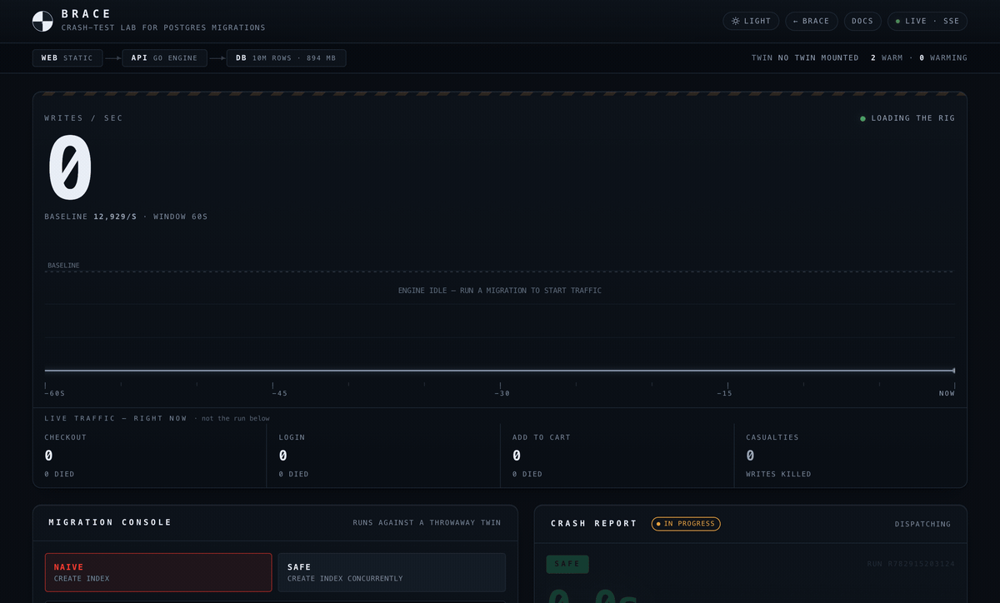
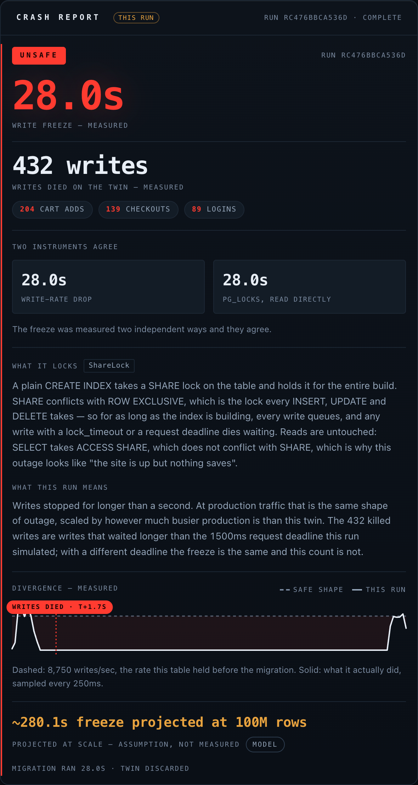

# I built a migration tester that refuses to lie — and "refuses to lie" was 80% of the work

Most of a hackathon is spent building features. I spent most of mine deleting confidence.

The tool is **Brace** — a crash-test lab for Postgres migrations. You paste a migration, it clones your database at production scale, runs the migration against that clone under live write traffic, and counts how many real writes died. Not "this takes a `SHARE` lock" — an actual body count: *28.0 seconds of frozen writes, 432 checkouts killed.*

That part took a weekend. The part that took the rest of the time was making sure it would rather say **"I don't know"** than tell you something was safe when it wasn't. Because a migration tester that's wrong once is worse than no tool at all — it's a tool that gets you paged at 2am *with your guard down.* This post is about the bugs that taught me that, and what "never lie" actually costs.


*A plain `CREATE INDEX`, live: writes crater to zero on a throwaway twin while the casualty count climbs.*

## The thing lock theory can't do

Everyone who's shipped a schema migration knows the theory: a plain `CREATE INDEX` takes a lock that blocks writes; add `CONCURRENTLY` and it doesn't. It's in a dozen blog posts. And it still takes people down, because *knowing* "this takes a ShareLock" is not the same as *feeling* that this freezes checkout for 28 seconds and kills 432 orders.

So Brace doesn't read your SQL and pattern-match like a linter. It runs it. On a real, throwaway Postgres twin, cloned from a seeded 10M-row template with `CREATE DATABASE … TEMPLATE` and dropped with `DROP DATABASE … WITH (FORCE)` after. A load generator hammers the twin with labeled writes — `checkout`, `login`, `add_to_cart` — while a monitor samples `pg_locks` every 250ms. When a write waits past its `lock_timeout` and dies with SQLSTATE `55P03`, that's a casualty. Counted, not modeled.

The demo is honestly kind of beautiful: same index, `CREATE INDEX` vs `CREATE INDEX CONCURRENTLY`, identical end state — one is a 28-second outage, the other is invisible. But the demo isn't the hard part.


*The report card from that run — the freeze measured two independent ways (write-rate collapse and `pg_locks`), casualties by label, and the lock explained in plain English.*

## Every way it tried to lie to me

The hard part is that a tool measuring "is this safe?" has a hundred ways to accidentally say **yes** when the truth is **no**. I found them by attacking my own tool — eventually with coding agents pretending to be a skeptical DBA — across about 30 adversarial runs. Here are the ones that scared me:

**The load ran as superuser.** The write traffic hitting the twin initially ran as the database superuser. Sounds harmless until you remember a migration is *caller-supplied SQL*, and a `CHECK` constraint or a column `DEFAULT` gets evaluated as the session that writes the row. Someone could have smuggled `pg_read_file('/etc/passwd')` into a `DEFAULT` and had my load generator run it as superuser. The fix wasn't a regex blocklist — it was two least-privilege roles, `brace_migrator` and `brace_traffic`, both `NOSUPERUSER NOCREATEDB`. The role is the boundary. The allow-list is just UX. (`pg_read_file` now fails with *permission denied*, by construction.)

**A rewrite that read as safe.** `ALTER TABLE orders ADD COLUMN x text DEFAULT random()::text` looks like a cheap metadata change. It isn't — a *volatile* default forces a full table rewrite under `ACCESS EXCLUSIVE`. An early version of my classifier waved it through as catalog-only. Now the rule is an allow-list of *constant* defaults; anything it doesn't recognize is assumed to rewrite. When in doubt, assume the worse lock.

**SAFE on a table that doesn't exist.** A migration against a table the lab doesn't have would fast-path to a clean SAFE — because "nothing happened" and "nothing bad happened" look identical to a naive verdict. That's the single most dangerous thing the tool could say. Now a missing relation is `ERRORED`, and it names the relation. Never blessed.

**The freeze that's invisible until production.** A metadata-only `ADD COLUMN` grabs its `ACCESS EXCLUSIVE` lock *instantly* on an idle twin — 0.0s, looks safe. But in production it has to *wait* for that lock behind your longest-running transaction, and once it's queued, every write queues behind it. The twin never showed it. So Brace now attaches a qualifier — `acquisition_not_simulated` — to exactly that shape, and a "hostile mode" that holds a real transaction open so it can *measure* the acquisition wait instead of assuming it.

**A projection that invented a freeze.** To warn about scale, Brace extrapolates a measured freeze onto your real row count. An early version of that model happily projected a freeze onto shapes that *don't block writes at all*, turning a genuinely safe change red. Now the monitor's observed lock mode is the arbiter, the projection only ever escalates a measured SAFE to UNSAFE (never fabricates), and past a ~20× extrapolation it flags itself `modeled_beyond_measurement` — because a 200× linear projection is arithmetic wearing a measurement's clothes, and index-build cost is super-linear anyway, so the number is a *lower bound*, not a fact.

The invariant that fell out of all this: **Brace never returns SAFE without a measurement, or an explicit, labeled confession of what it didn't test.** That one sentence is the whole product. Every feature after it had to preserve it. When I later used a fan-out of agents to design new features, I made a reviewer agent whose only job was to try to break that invariant — and it caught three more reachable false-SAFEs *before any of that code shipped.*

## The Zerops-specific gotcha

Brace needs a Postgres it *owns* — superuser, arbitrary `CREATE DATABASE`, `TEMPLATE` cloning, direct `pg_locks` reads. Almost every managed Postgres forbids all four. [Zerops](https://zerops.io) hands you a real one, which is the one thing that makes the twin mechanism possible. Four services from a single `import.yml` — Go engine, static dashboard, Python MCP endpoint, and the database on dedicated vCPU — talking over a private network, so the superuser DSN never leaves the project.


*Screenshot: your Zerops project dashboard — the four services and the topology.*

One thing that ate an hour: I exposed Brace as a remote **MCP** server so any coding agent can crash-test a migration by URL. It kept returning 400. The platform proxy was turning `POST /mcp/` into a `307 → GET /mcp`, which silently downgrades the request and breaks the streamable-HTTP handshake. The fix was an ASGI path-normalizing wrapper that serves both `/mcp` and `/mcp/` directly — the kind of thing you only find by reading the actual network trace, not the docs.

```bash
# any agent gates its own migrations, nothing installed:
claude mcp add --transport http brace https://mcp-2a61-8080.prg1.zerops.app/mcp
```

Then you ask your agent *"check this migration before you ship it,"* and it comes back with UNSAFE, the casualty count, and the `CONCURRENTLY` rewrite — and refuses.

## What I'd tell my past self

Two things.

**A measurement tool's real product is knowing where it stops being true.** The features are easy; the honesty is the moat. Every hour I spent making Brace admit what it *didn't* measure bought more trust than any feature would have. A tool that says "I didn't test the acquisition wait — turn on hostile mode" is one a DBA will actually believe when it says UNSAFE.

**Show the scars.** The docs have a whole "what we got wrong — and fixed" section: the superuser hole, the false-SAFE class, the phantom projection, the proxy downgrade. Counterintuitively, a tool that names its own twenty edges precisely reads as *more* trustworthy, not less. Hiding the limits is what makes people stop believing the greens.

Brace is live — paste a migration and watch it crash a twin, not your users. But the thing I'm actually proud of isn't the crater. It's that across 30 runs designed to trip it, it never once said "safe" about something that wasn't. That property is the entire point, and it's the part that was 80% of the work.

**Try it:** the live lab · the repo · connect your own agent with the one-liner above.
